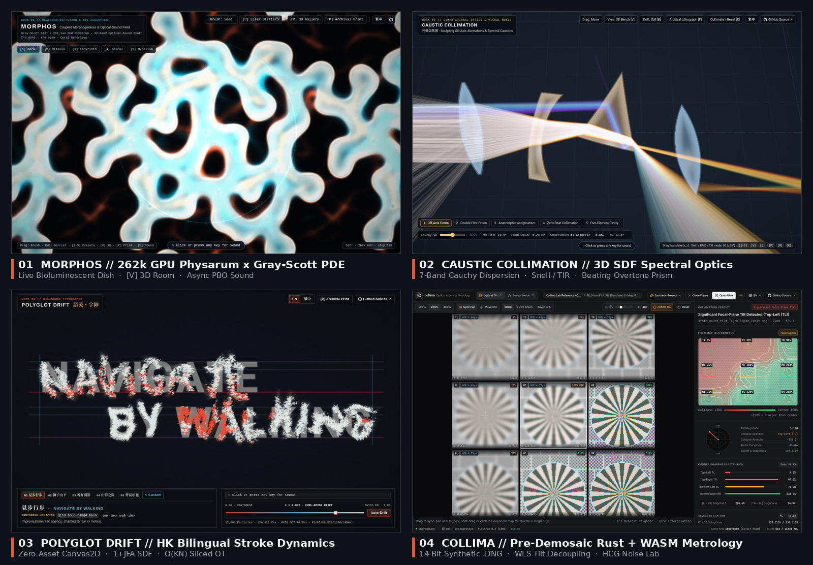

# h-void

### *Perceptual Computation: Rendering Invisible Signals Visible, Audible, and Playable*

**Systems Programmer & Computational Media Artist** · Rust · WebAssembly · WebGL2 / GLSL · Web Audio (`AudioWorklet`) · Computational Optics & Imaging

> I build browser-native computational systems from mathematical first principles—where every visual frame, optical ray, typographic stroke, and acoustic tone is synthesized live in the browser across reaction-diffusion morphogenesis, spectral optics, Hong Kong bilingual typography, and pre-demosaic camera sensor physics.

  

---

## Featured Works · *Perceptual Computation* Quartet

| Work | Interactive Instrument | Core Computation & Media Architecture | Live Experience | Source |
| :---: | :--- | :--- | :---: | :---: |
| **01** | **MORPHOS // 菌脈・聲場** | WebGL2 9-point Gray-Scott PDE · `262,144` GPU Transform-Feedback *Physarum* · Radial Optical Scanner → `AudioWorklet` 32-band Modal Synth · `[V]` Raycasted 3D Black-Box Room |  | [Repo ↗](https://github.com/h-void/morphos) |
| **02** | **CAUSTIC COLLIMATION // 光軸與焦散** | WebGL2 3D Implicit SDF Optical Bench (`N-BK7` & `SF11`) · 3D Vector Snell Refraction, Fresnel & TIR · 7-Band Cauchy Dispersion (`420–680 nm`, `γ_D = 3.5×`) · Stereo Beating Overtone Prism |  | [Repo ↗](https://github.com/h-void/caustic-collimation) |
| **03** | **POLYGLOT DRIFT // 語流・字陣** | Live HK Cantonese–English & Custom Text `Canvas2D` → WebGL2 `1+JFA` 2D SDF · `12,000` Stroke Particles · `< 5 ms` `O(KN)` 256-Bucket Sliced OT · 3-Filter Vocal Synth |  | [Repo ↗](https://github.com/h-void/polyglot-drift) |
| **04** | **COLLIMA // Seeing Before the ISP** | Rust 2024 Core (`205 KB` src) → Client WebAssembly (`~1.7 MB` gz) · In-Memory 14-Bit Synthetic `.DNG` Engine · Pre-Demosaic `G₁/G₂` WLS Optical Tilt / Field Curvature Separation · Dual-Native ISO (`HCG`) Noise Lab |  | [Repo ↗](https://github.com/h-void/collima) |

---

*Works 01–03 share deterministic seeded randomness, automatic WebGL2 `RGBA16F ↔ RGBA8` fallbacks, and `[P]` archival print modes; Work 04 compiles its Rust imaging core directly to client-side WebAssembly. All four live works support English and Traditional Chinese interfaces.*
