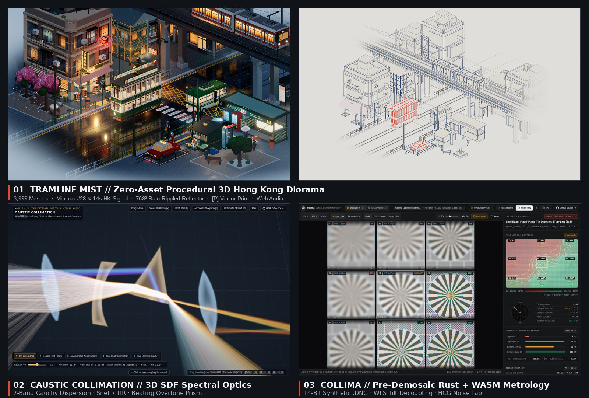

# h-void

### *Procedural 3D Space, Computational Optics & Sensor Metrology*

**Systems Programmer & Computational Media Artist** · TypeScript · Three.js / GLSL · WebGL2 · Web Audio (`AudioWorklet`) · Rust & WebAssembly

> I build zero-asset browser-native computational systems from first principles—where every 3D architectural volume, planar wet-road reflection, caustic optical ray, synthetic 14-bit camera RAW frame, and acoustic wave is synthesized live in code.

  

---

## Featured Works · Zero-Asset Pure-Code Trio

| Work | Interactive System | Core Computation & Media Architecture | Live Experience | Source |
| :---: | :--- | :--- | :---: | :---: |
| **01** | **TRAMLINE MIST // 香江雨霧・叮叮** | Zero-Asset Procedural 3D Hong Kong Diorama (`3,999` Meshes, `119.5k` Tris, `~232 KB` gz) · Orthographic `768² HalfFloat` Rain-Rippled `PlanarWetReflector` · 3D Neon Halos & Radial Mist GLSL · 14s Synced HK Signal, Minibus `#28` & Living Street · `[P]` Xuan-Paper Print + Vector SVG · `[A]` GLSL Acoustic Field & HK Crossing Audio |  | [Repo ↗](https://github.com/h-void/hk-tram-mist) |
| **02** | **CAUSTIC COLLIMATION // 光軸與焦散** | WebGL2 3D Implicit SDF Optical Bench (`N-BK7` & `SF11`) · 3D Vector Snell Refraction, Fresnel & TIR · 7-Band Cauchy Dispersion (`420–680 nm`, `γ_D = 3.5×`) · Stereo Beating Overtone Prism |  | [Repo ↗](https://github.com/h-void/caustic-collimation) |
| **03** | **COLLIMA // Seeing Before the ISP** | Rust 2024 Core (`205 KB` src) → Client WebAssembly (`~1.7 MB` gz) · In-Memory 14-Bit Synthetic `.DNG` Engine · Pre-Demosaic `G₁/G₂` WLS Optical Tilt / Field Curvature Separation · Dual-Native ISO (`HCG`) Noise Lab |  | [Repo ↗](https://github.com/h-void/collima) |

---

*All three featured works launch directly in any modern browser with zero external 3D models, stock images, or audio samples, and support both English (`?lang=en`) and Traditional Chinese interfaces.*
